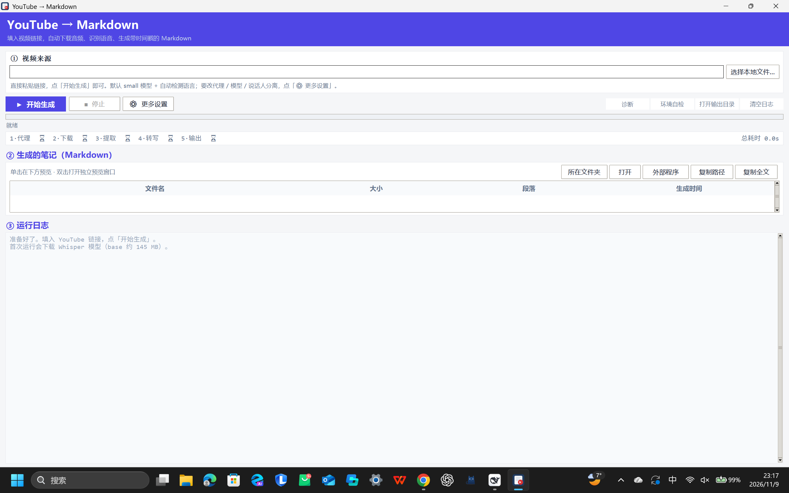

# video2markdown

把视频（YouTube / Bilibili 链接，或本地文件）转成**带时间戳的 Markdown 笔记**。
全本地运行，不需要 API key，不上传任何东西。

<p align="center">
  
</p>

---

## 一、先用起来（不需要懂技术）

### 第 1 步：下载

打开 **[Releases](https://github.com/log-ultimatia/video2markdown/releases)** 页面，
下载最新的 **`video2markdown-windows-x64.zip`**（约 130 MB）。

### 第 2 步：解压

右键 → **全部解压缩** → 得到一个 `video2markdown` 文件夹。
**放到你自己找得到的地方**（比如 `D:\video2markdown`），不要放在压缩包里直接运行。

### 第 3 步：双击

双击里面的 **`video2markdown.exe`**，界面就出来了。

> **不需要安装 Python，不需要 pip，不需要 ffmpeg，不需要配置任何东西。**
> 这些都已经打包在里面了。

### 第 4 步：用

1. 把视频链接粘贴到最上面的输入框
2. 点 **▶ 开始生成**
3. 等它跑完，笔记会出现在 `output` 文件夹里（界面上「打开输出目录」按钮可直接打开）

**第一次运行会等久一点**（约 1~3 分钟）：它在下载语音识别模型（约 480MB）。
日志区会显示进度，**不是卡死了**。下载完之后再用就很快了。

---

## 二、你可能会遇到的问题

| 现象 | 原因 / 怎么办 |
|---|---|
| Windows 提示"未知发布者" | 正常，软件没做代码签名。点 **更多信息 → 仍要运行** |
| 提示连不上 YouTube | 需要代理。在「⚙ 更多设置」里填代理地址（默认 `http://127.0.0.1:7890`），然后点「检测」 |
| 第一次运行等很久 | 在下模型（约 480MB），日志区有进度 |
| 觉得慢 | 关掉「说话人分离」（它会让时间翻倍）；或看下面「GPU 加速」 |
| 中文出现繁体 | 下载新版即可，已修 |
| 转写内容不准 | 在「⚙ 更多设置」里把模型换成 `medium`，并把视频里的人名填进「专有名词」 |

---

## 三、想更快？GPU 加速（可选，能快 3~4 倍）

**前提：电脑有 NVIDIA 显卡。**

### 第 1 步
在 Releases 页面额外下载 **`video2markdown-gpu-addon.zip`**（约 900 MB）。

### 第 2 步
把它解压到**和 `video2markdown.exe` 同一个文件夹**里，
解压后应该长这样：

```
video2markdown\
├── video2markdown.exe
├── v2m-cli.exe
├── nvidia\              ← 新增的这个
├── _internal\
├── output\
└── ...
```

### 第 3 步
重新打开 `video2markdown.exe`。日志里如果出现 `使用 cuda/int8_float16` 就说明生效了。

| | 6 分钟视频耗时 |
|---|---|
| 不用 GPU（默认） | 约 95~110 秒 |
| **用了 GPU** | **约 30~40 秒** |

---

## 四、这工具有什么特别的

大部分同类工具是**字幕抓取器** —— 视频没字幕就完全没法用。
这个工具永远跑本地语音识别，任何视频都能转。

第二个不同：**中英混排视频**。一支视频里中英交替时，普通做法会把英文段整段丢掉，
或者把它**翻译**成中文（内容看着通顺，但已经不是原话）。这个工具会先找出语言切换点，
把音频切段后分别识别。实测同一支中英混排视频，Buzz（22k 星的桌面工具）丢了 75% 内容，
这里完整保留。

另外还有：

| 功能 | 说明 |
|---|---|
| 中文标点补全 | 中文缺标点时自动补 `，。？`，并统一全角 |
| 中英文之间空格 | `数学频道Numberphile` → `数学频道 Numberphile` |
| 说话人分离（可选） | 多人对话时给每段标 `[S1] [S2]`；**已知人数请手选，自动估算不准** |
| 专有名词偏置 | 填 `陶哲轩,Numberphile` 能显著提升人名准确率 |
| 断点续跑 | 中途停止后可以从断点继续，不用重跑 |

---

## 五、给开发者：从源码运行

```bash
# 需要 Python 3.10 ~ 3.13（3.14/3.15 装不上，见下方说明）
git clone https://github.com/log-ultimatia/video2markdown.git
cd video2markdown
python -m venv .venv
.venv\Scripts\activate            # macOS/Linux: source .venv/bin/activate
pip install -r requirements.txt
python check_env.py               # 环境自检，全绿再往下
python main.py                    # 图形界面
```

命令行用法：

```bash
python main.py --run-pipeline "https://www.youtube.com/watch?v=XXX" --model small
python main.py --run-pipeline video.mp4 --model small
python main.py --run-pipeline URL --vocab "陶哲轩,Numberphile" --diarize --num-speakers 2
```

<details>
<summary><b>为什么 Python 3.14 / 3.15 装不上？</b></summary>

不是本项目的问题，是上游依赖还没发对应版本的预编译包：

| 依赖 | 要求 | 3.15 轮子 |
|---|---|---|
| `av`（PyAV） | ≥3.12 | ❌ 没有 |
| `onnxruntime` | ≥3.11 | ❌ 没有 |

在 3.14+ 上 `pip install` 会去编译 `av`，需要 FFmpeg 开发头文件，基本必然失败。

**绿色版内置 Python 3.13，所以不受这个限制** —— 这也是推荐普通用户直接下载 zip 的原因。
</details>

<details>
<summary><b>自己打包 exe</b></summary>

```bash
pip install pyinstaller
python -m PyInstaller --noconfirm --clean packaging/video2markdown.spec
# 产物在 packaging/dist/video2markdown/
```

打包配置见 [`packaging/video2markdown.spec`](packaging/video2markdown.spec)。
打 tag 会自动构建并发版（见 [`.github/workflows/release.yml`](.github/workflows/release.yml)）。
</details>

---

## 六、文档

| 文档 | 内容 |
|---|---|
| [docs/README.md](docs/README.md) | 全部文档索引 |
| [docs/TECHNICAL_NOTES.md](docs/TECHNICAL_NOTES.md) | 实现笔记：设计取舍、参数理由、实测数据 |
| [docs/VALIDATION_noise_and_diarization.md](docs/VALIDATION_noise_and_diarization.md) | 实测报告：噪声影响、降噪是否有用、说话人分离准确率 |
| [docs/LANDSCAPE.md](docs/LANDSCAPE.md) | 同类开源项目与商业软件调研 |

---

## 七、许可

[MIT](LICENSE)。核心依赖：[faster-whisper](https://github.com/SYSTRAN/faster-whisper)（MIT）、
[CTranslate2](https://github.com/OpenNMT/CTranslate2)（MIT）、
[yt-dlp](https://github.com/yt-dlp/yt-dlp)（Unlicense）、
[OpenCC](https://github.com/BYVoid/OpenCC)（Apache-2.0）、FFmpeg（LGPL/GPL）。

---

<details>
<summary><b>English</b></summary>

**video2markdown** turns a video (YouTube/Bilibili URL or a local file) into a
timestamped Markdown transcript, fully locally — no API key, no cloud.

**Windows users**: grab `video2markdown-windows-x64.zip` from
[Releases](https://github.com/log-ultimatia/video2markdown/releases), unzip, and
double-click `video2markdown.exe`. Python, ffmpeg and all dependencies are bundled.

Downloading `video2markdown-gpu-addon.zip` into the same folder enables NVIDIA GPU
acceleration (~3–4× faster).

Unlike caption scrapers, it always runs local ASR, so videos without subtitles work.
For code-switching audio (Chinese + English in one video) it detects language
boundaries and transcribes each segment separately — otherwise Whisper silently
*translates* the English into Chinese.

Source install requires Python 3.10–3.13 (3.14+ lacks wheels for `av`/`onnxruntime`;
the packaged build embeds Python 3.13).

MIT licensed.
</details>
