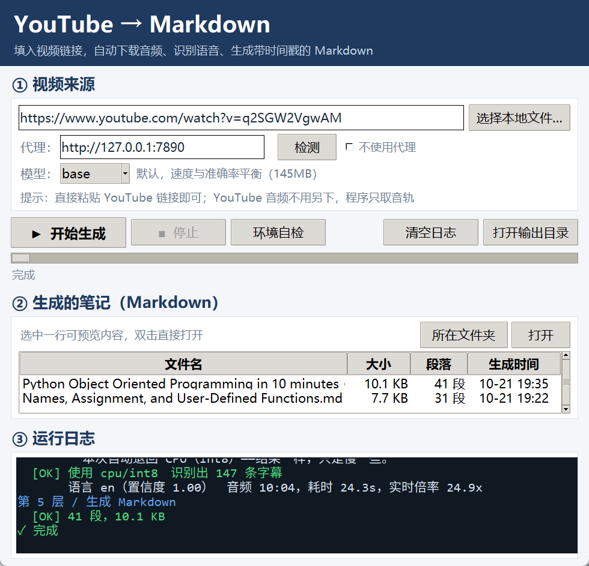
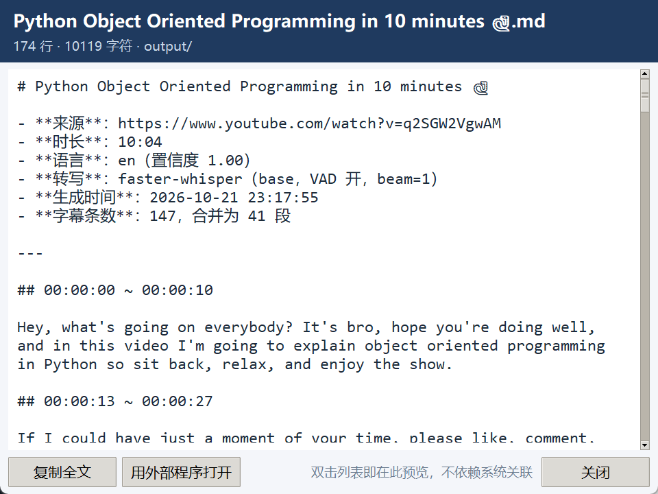

# video2markdown

> Turn a video (YouTube URL or local file) into a readable Markdown transcript with timestamps — **fully local, no API key, no LLM**.
>
> 把视频（YouTube 链接或本地文件）转成**带时间戳的 Markdown 逐段文本** —— 全本地运行，不要 API key，不要大模型。

<p align="center">
  
</p>

[](https://github.com/log-ultimatia/video2markdown/actions/workflows/ci.yml)
[](LICENSE)
[](https://www.python.org/downloads/)

`Python` · `Windows-first GUI` · `faster-whisper` · `MIT`

---

## English

### What it does

Paste a YouTube URL (or pick a local file) → it downloads only the audio track, normalizes it to 16 kHz mono WAV via FFmpeg, transcribes it with faster-whisper, and writes a Markdown file with `## 00:00:00 ~ 00:00:34` style paragraphs.

### Why another one?

Most existing tools are **caption scrapers**: they read YouTube's subtitles and fail completely when a video has no captions. This one always runs local ASR, so it works on any video.

The second difference: **mixed-language videos**. A video that switches between Chinese and English mid-way breaks naive Whisper setups — the language must be detected *per region*, not once for the whole file. This project chunks audio into 60-second blocks and detects the language inside each block.

On a real bilingual video (Chinese narration + an English interview, 6 minutes), a popular desktop app (**Buzz**, 22k stars) silently **dropped 75% of the content** — it skipped the entire English segment. This project captured all of it. See [docs/COMPARISON_buzz.md](docs/COMPARISON_buzz.md).

### Install

```bash
# 1. FFmpeg is required (it is not a pip package)
#    Windows: winget install Gyan.FFmpeg   |  or get it from ffmpeg.org
#    macOS:   brew install ffmpeg
#    Linux:   sudo apt install ffmpeg
ffmpeg -version

# 2. Python 3.10+ (tested on 3.13)
python -m venv .venv
source .venv/bin/activate          # Windows: .venv\Scripts\activate
pip install -r requirements.txt

# 3. Verify everything is in place
python check_env.py
```

### Usage

```bash
# YouTube URL
python pipeline.py "https://www.youtube.com/watch?v=VIDEO_ID" --model small

# Local file
python pipeline.py /path/to/video.mp4 --model small

# With a proxy (YouTube is unreachable from mainland China without one)
python pipeline.py URL --proxy http://127.0.0.1:7890

# Force a language instead of auto-detecting
python pipeline.py URL --lang en

# 选择推理设备：auto / cpu / cuda
python pipeline.py URL --device cuda

# Intel Ultra NPU（OpenVINO）
python pipeline.py URL --device npu --model small

# 登录/会员视频：传入 Netscape HTTP Cookie File
python pipeline.py URL --cookies D:\path\cookies.txt

# 或直接从浏览器读取 Cookies
python pipeline.py URL --cookies-from-browser chrome
```

Or launch the GUI:

```bash
python app.py
```

### Output

```markdown
# Video Title

- **来源**：https://www.youtube.com/watch?v=...
- **时长**：8:46
- **语言**：en（置信度 1.00）
- **转写**：faster-whisper（small，VAD 开，beam=1）

---

## 00:00:01 ~ 00:00:20

Today we're going to talk about names and how they work. So let me show you
a quick demonstration to get us started. I'll start up Python...

## 00:00:20 ~ 00:00:34
```

Subtitle lines are merged into ~180-character paragraphs, because subtitles are cut for on-screen display while people read in continuous prose.

### Features

| | |
|---|---|
| Local ASR, no cloud, no API key | ✅ |
| Works without captions | ✅ |
| **Mixed-language (code-switching) videos** | ✅ per-60s language detection |
| **Resume after interruption** | ✅ checkpoint every ~2 s |
| Simplified Chinese + punctuation | ✅ prompt + OpenCC fallback |
| Proxy support | ✅ CLI arg / env var / system default |
| Model choice | tiny / base / small / medium / large-v3 |

### Performance

Measured on CPU (int8), 8:46 English video (526 s audio):

| Stage | Time | Ratio |
|---|---|---|
| Download audio (6.8 MB) | 2.9 s | — |
| FFmpeg extract | 2.4 s | 219× realtime |
| Transcribe (`base`) | 24.3 s | 21.7× realtime |
| Transcribe (`small`) | ~70 s | 7.9× realtime |

GPU is used automatically when a CUDA runtime is available; otherwise it falls back to CPU.

---

## 中文

### 它做什么

贴一个 YouTube 链接（或选本地文件）→ 只下载音轨 → FFmpeg 转成 16 kHz 单声道 WAV → faster-whisper 转写 → 输出带 `## 00:00:00 ~ 00:00:34` 时间戳段落的 Markdown。

<p align="center">
  
</p>

### 为什么又造一个轮子

**第一，市面上大多数工具是"字幕抓取器"** —— 它们读 YouTube 自带的字幕，遇到没有字幕的视频就直接罢工。这个项目永远跑本地 ASR，任何视频都能转。

**第二，中英混排视频。** 一支中文旁白 + 英文访谈交替的片子，会击穿朴素的 Whisper 配置：语言必须**按区域检测**，不能整段只判一次。这个项目把音频切成 60 秒一块、每块内部单独检测语言。

有对照数据：拿一支真实的中英混排视频（中文旁白 + Terence Tao 英文访谈，6 分钟）和 Buzz（22k 星的桌面转写工具）比，Buzz **静默丢掉了 75% 的内容**（英文访谈段整段跳过），本项目全部拿到。详见 [docs/COMPARISON_buzz.md](docs/COMPARISON_buzz.md)。

### 安装

```powershell
# 1. FFmpeg 是硬依赖（不是 pip 包）
#    Windows: winget install Gyan.FFmpeg   或从 ffmpeg.org 下载后加进 PATH
#    macOS:   brew install ffmpeg
#    Linux:   sudo apt install ffmpeg
ffmpeg -version

# 2. Python 3.10 以上（实测 3.13）
python -m venv .venv
.venv\Scripts\activate              # macOS/Linux: source .venv/bin/activate
pip install -r requirements.txt

# 3. 环境自检（逐项检查 Python / ffmpeg / 代理 / 依赖 / 目录）
python check_env.py
```

### 用法

```powershell
# YouTube 链接
python pipeline.py "https://www.youtube.com/watch?v=VIDEO_ID" --model small

# 本地文件（mp4 / webm / mkv / mov / mp3 / wav）
python pipeline.py D:\videos\lecture.mp4 --model small

# 走代理（默认就用 http://127.0.0.1:7890）
python pipeline.py URL --proxy http://127.0.0.1:7890

# 强制语言，跳过自动检测
python pipeline.py URL --lang zh

# 选择推理设备（Intel Ultra NPU）
python pipeline.py URL --device npu --model small

# 忽略断点缓存，从头转写
python pipeline.py URL --no-resume

# 登录/会员视频：传入导出的 Netscape HTTP Cookie File
python pipeline.py URL --cookies D:\path\cookies.txt

# 或从浏览器读取 Cookies
python pipeline.py URL --cookies-from-browser edge
```

图形界面：

```powershell
python app.py
```

Windows 用户还可以用 `create_shortcut.ps1` 生成桌面快捷方式（带图标、无控制台窗口）。

### 图形界面

<p align="center">
  
</p>

界面分四块：**① 视频来源**（链接/本地文件、代理、模型、语言）→ **操作栏 + 进度 + 阶段面板** → **② 生成的笔记列表** → **③ 运行日志**。

进度条下面那排是**阶段面板**，五个阶段的耗时一眼可见，进行中的秒数每 100 ms 刷新：

```
1·代理  ✓ 0.0s   2·下载  ✓ 2.9s   3·提取  ✓ 2.4s   4·转写  ⟳ 12.3s   5·输出  ⏳     总耗时 18.1s
```

### 五层流水线

| 层 | 做什么 | 关键实现 |
|---|---|---|
| 1 | 解析代理 | CLI > 硬编码 > 环境变量 > 默认 7890，带端口连通性检测 |
| 2 | 下载音频 | `yt-dlp` 优先只取独立音轨；没有独立音轨时选最低画质的合并流 |
| 3 | 提取音频 | `ffmpeg -vn -ac 1 -ar 16000 -c:a pcm_s16le` |
| 4 | 语音转文字 | `faster-whisper` + CTranslate2，CPU int8 / GPU float16 |
| 5 | 生成 Markdown | 相邻字幕按语义合并成 ~180 字段落 |

### 三个关键技术点

**① 中英混排不丢段**

整段一次性转写时，模型会延续上一段的语言上下文，把纯英文段念成"中文字幕/中文文字"这类复读幻觉。实测同一段 150 秒中英混排素材：

| 做法 | 英文词 | 幻觉 |
|---|---|---|
| 整段一次性 | 1 | 13 |
| 逐块 120 秒 | 16 | 0 |
| **逐块 60 秒** | **116** | **0** |

所以默认按 60 秒分块，每块单独检测语言、单独挑提示词。

**② 断点续跑**

转写占整条流水线 80% 的时间。每产生几条字幕（或距上次超过 2 秒）就把已转部分写进 `audio/<名字>.segments.json`；下次从最后一条字幕的结束时间**往回退 2 秒**继续，重叠段按时间戳去重。

中断后重启，日志里会看到：

```
[续跑] 已有 24 条字幕，从 1:56 处继续（共 12:00）
```

**③ 简体中文 + 标点**

Whisper 对中文默认输出繁体、而且经常整段不加标点。给它一段"普通话书面语"示例当 `initial_prompt` 就能纠正：

| 配置 | 耗时 | 繁体字 | 标点 |
|---|---|---|---|
| 不给提示词 | 4.1s | **82** | **0** |
| 给提示词 | **2.4s** | **0** | **11** |

注意加了提示词**反而更快**。另外还有 OpenCC 的 `t2s` 作为兜底。

### 性能

CPU（int8）实测，8:46 英文视频（526 秒音频）：

| 阶段 | 耗时 | 倍率 |
|---|---|---|
| 下载音频（6.8 MB） | 2.9s | — |
| FFmpeg 提取 | 2.4s | 219x |
| 转写（`base`） | 24.3s | 21.7x |
| 转写（`small`） | ~70s | 7.9x |

有 CUDA 运行库时自动用 GPU，否则退回 CPU。加速手段包括 int8 量化、贪心解码（`beam_size=1`）、VAD 掐静音、只下音轨、模型实例复用。

### 常见问题

**Q：提示 "Unable to download API page" / 连不上 YouTube**
国内直连 YouTube 不通。确认代理软件在跑、端口对得上：

```powershell
python pipeline.py URL --proxy http://127.0.0.1:7890
```

界面上的「检测」按钮只测端口通不通，2 秒出结果。

**Q：模型下载很慢或失败**
默认走 `HF_ENDPOINT=https://hf-mirror.com`。想自己指定：

```powershell
$env:HF_ENDPOINT = "https://hf-mirror.com"
```

**Q：中文一直是繁体**
检查是否手动指定了语言。保持「自动检测/混合」或指定 `--lang zh` 会挑到中文提示词。

**Q：转写很慢**
`small` 在 CPU 上约 8 倍实时（1 小时视频约 8 分钟）。想更快用 `--model base`（约 20 倍实时）；想更准用 `--model medium`。
装了 CUDA 运行库会自动用 GPU：`pip install nvidia-cublas-cu12 nvidia-cudnn-cu12`。
GUI 和 CLI 都支持设备切换：`auto`、`cpu`、`cuda`、`npu`。Intel NPU 使用 OpenVINO Whisper int8 模型。

NPU 后端是**可选**的，OpenVINO 不在默认依赖里（要多下几百 MB）。只有确定自己有
Intel NPU 时才需要装：

```powershell
.venv\Scripts\python.exe -m pip install "openvino>=2026.4" "openvino-genai>=2026.4"
```

不装也能正常跑 CPU / CUDA；如果选了 `--device npu` 而没装，会给出明确提示。

**Q：界面上的「外部程序」「所在文件夹」按钮没反应**
某些 Windows 环境（第三方 shell 扩展注入）会让 `explorer.exe` / `Code.exe` 以 `0xC0000142` 退出。可以用界面里的「复制全文」「复制路径」兜底，或运行 `tools/diag_open.bat` 生成诊断日志。

### 平台支持

| | 状态 |
|---|---|
| **核心 CLI**（`pipeline.py` / `check_env.py`） | 跨平台（Windows / macOS / Linux），只依赖 FFmpeg + Python |
| **图形界面**（`app.py`） | **Windows 优先**。用到了 `os.startfile`、`shlwapi` 文件关联查询、`.ps1` 快捷方式等 Windows 特性；其它平台能跑，但若干便利功能不可用 |

### 更多文档

完整索引见 [docs/README.md](docs/README.md)。

| 文档 | 内容 |
|---|---|
| [TECHNICAL_NOTES.md](docs/TECHNICAL_NOTES.md) | 实现笔记：设计取舍、关键参数理由、实测数据 |
| [LANDSCAPE.md](docs/LANDSCAPE.md) | 同类开源项目与商业软件调研 |
| [COMPARISON_buzz.md](docs/COMPARISON_buzz.md) | 与 Buzz 的双语视频实测对比 |
| [COMPARISON_3way.md](docs/COMPARISON_3way.md) | 与 tube2note、video-to-notes 的三方对比 |
| [OUTPUT_SAMPLES.md](docs/OUTPUT_SAMPLES.md) | 三方案输出样例对照 |

### 依赖与许可

核心依赖：[faster-whisper](https://github.com/SYSTRAN/faster-whisper)（MIT）、[CTranslate2](https://github.com/OpenNMT/CTranslate2)（MIT）、[yt-dlp](https://github.com/yt-dlp/yt-dlp)（Unlicense）、[OpenCC](https://github.com/BYVoid/OpenCC)（Apache-2.0）、FFmpeg（LGPL/GPL）。

本项目以 [MIT](LICENSE) 许可发布。
